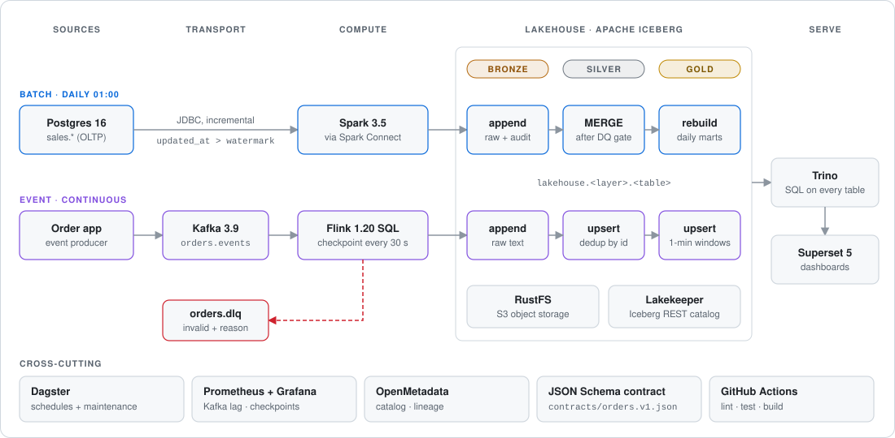
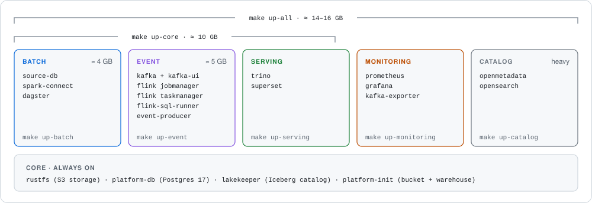
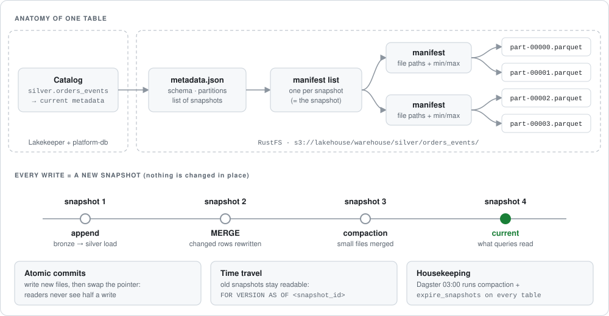
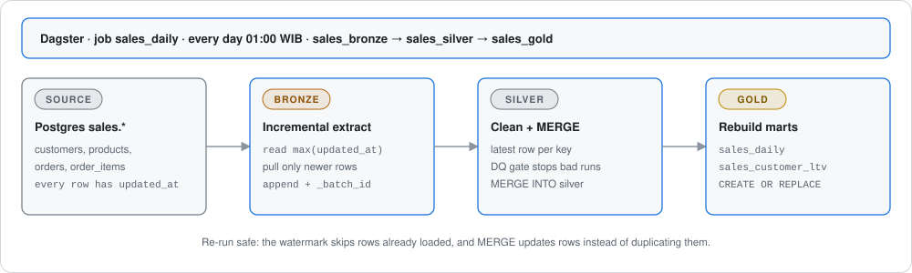
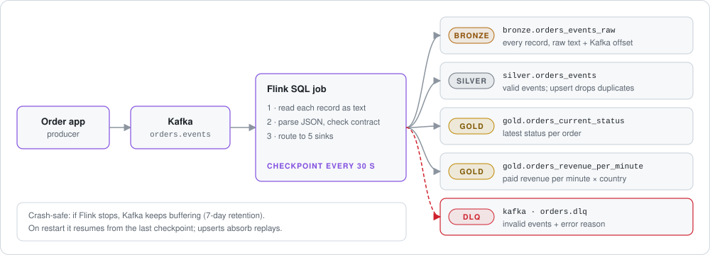

# onprem-lakehouse

[](https://github.com/kurnivan-ny/onprem-lakehouse/actions/workflows/ci.yml)

An **on-premise data lakehouse** you can run on one machine with Docker. It has two ways of getting data in:

- **batch**: Spark copies a Postgres database once a day, loading only what changed
- **event**: Flink reads order events from Kafka continuously and writes them every 30 seconds

Both land in the same **Apache Iceberg** tables, organised as **bronze → silver → gold**. You query them with Trino and build dashboards in Superset. Every component is open-source and free, and no data leaves your machine.

<p align="center">
  
</p>

## Contents

- [Quick start](#quick-start)
- [Choose what to run](#choose-what-to-run)
- [How each piece works](#how-each-piece-works)
  - [Apache Iceberg: the table format](#apache-iceberg-the-table-format)
  - [Lakekeeper + RustFS: catalog and storage](#lakekeeper--rustfs-catalog-and-storage)
  - [Bronze, silver, gold: the medallion layers](#bronze-silver-gold-the-medallion-layers)
  - [Batch pipeline: Spark + Dagster](#batch-pipeline-spark--dagster)
  - [Data-quality gate](#data-quality-gate)
  - [Event pipeline: Kafka + Flink](#event-pipeline-kafka--flink)
  - [Event contract + dead-letter queue](#event-contract--dead-letter-queue)
  - [Trino + Superset: query and dashboards](#trino--superset-query-and-dashboards)
  - [Dagster: orchestration](#dagster-orchestration)
  - [Monitoring: Prometheus + Grafana](#monitoring-prometheus--grafana)
  - [OpenMetadata: data catalog](#openmetadata-data-catalog)
- [Try the patterns](#try-the-patterns)
- [Service URLs](#service-urls)
- [Repo layout](#repo-layout)
- [Development and CI](#development-and-ci)
- [Operations notes](#operations-notes)

---

## Quick start

**You need:** Docker + Docker Compose v2.20+ (WSL2 on Windows works) and `make`.
The first build downloads about 5 GB of images and jars. Later starts work offline.

```bash
make init            # creates .env from .env.example (change the secrets if this isn't a laptop)
make up-core         # batch + event + serving (≈ 10 GB RAM)
make ps              # wait until platform-init and flink-sql-runner show "exited (0)"
```

Then try:

| I want to… | Go to |
|---|---|
| Run the batch pipeline | Dagster http://localhost:3000 → *Jobs* → `sales_daily` → *Materialize*, or `make batch-run` |
| Watch live events and rejects | Kafka UI http://localhost:8080 → topics `orders.events`, `orders.dlq` |
| Watch the streaming job | Flink UI http://localhost:8081 → `orders-pipeline` |
| Query any table with SQL | `make trino` → `SHOW TABLES FROM lakehouse.gold;` · or `make sql-samples` |
| Build dashboards | Superset http://localhost:8088 (admin / admin); Trino is already connected |
| Browse the table catalog | Lakekeeper http://localhost:8181/ui |

`make help` lists every shortcut.

## Choose what to run

The platform is split into **Docker Compose profiles**, so you start only the parts you need. The core (storage + catalog) always runs.

<p align="center">
  
</p>

| Command | Starts | RAM (approx.) |
|---|---|---|
| `make up-batch` | core + Postgres source, Spark, Dagster | 4 GB |
| `make up-event` | core + Kafka, Flink, producer, Dagster | 5 GB |
| `make up-serving` | core + Trino, Superset | — |
| `make up-core` | batch + event + serving (the everyday setup) | 10 GB |
| `make up-monitoring` | core + Prometheus, Grafana | — |
| `make up-catalog` | core + OpenMetadata (heavy) | — |
| `make up-all` | everything | 14–16 GB |
| `make down` / `make reset` | stop everything (keep data) / stop **and delete all data** | |

Dagster belongs to both `batch` and `event` because it schedules batch jobs and also checks Flink's health.

---

## How each piece works

Each section explains what the component is in plain terms, how this repo uses it, and how to see it working yourself.

### Apache Iceberg: the table format

**In short:** Iceberg turns a folder of Parquet files in object storage into a **real database table**. You get safe concurrent writes, `MERGE`/`UPDATE`, schema changes and time travel, without a database server.

<p align="center">
  
</p>

**How it works:**

1. **Data files.** Rows are stored as ordinary Parquet files in RustFS (S3).
2. **Metadata tree.** Iceberg keeps a small tree of metadata files next to the data:
   - `metadata.json` holds the schema, the partitioning and the list of snapshots.
   - Each snapshot has a **manifest list**, which points to **manifests**.
   - Manifests list the Parquet files with per-column min/max stats. Query engines use these stats to skip files that can't match.
3. **Catalog pointer.** The catalog (Lakekeeper) stores one thing per table: *which `metadata.json` is current*.
4. **Commits are atomic.** A writer (Spark, Flink) first writes new files, then asks the catalog to swap the pointer from the old metadata to the new. Readers see either the old version or the new one, never half of a write. If two writers collide, one retries.
5. **Nothing is edited in place.** Every write creates a **new snapshot**. Old snapshots stay readable, which gives you time travel and rollback, until maintenance expires them.

**In this repo:** every table (batch and event) is an Iceberg v2 table in the catalog `lakehouse`. Spark, Flink and Trino all read and write the **same** tables because they share one catalog.

**See it yourself (Trino):**

```sql
-- every commit to a table
SELECT snapshot_id, committed_at, operation
FROM lakehouse.silver."sales_orders$snapshots" ORDER BY committed_at DESC;

-- read the table as it was at an older snapshot
SELECT count(*) FROM lakehouse.silver.sales_orders FOR VERSION AS OF <snapshot_id>;

-- the Parquet files behind it
SELECT file_path, record_count FROM lakehouse.silver."sales_orders$files";
```

**Housekeeping:** streaming and `MERGE` create many small files and snapshots. Every night at 03:00, Dagster runs `rewrite_data_files` (compaction) and `expire_snapshots` (keeps 7 days, and at least the last 5 snapshots) on **every** table, including the ones Flink writes.

### Lakekeeper + RustFS: catalog and storage

| | What it does | Analogy |
|---|---|---|
| **RustFS** | S3-compatible object storage; holds every data and metadata file under `s3://lakehouse/warehouse/…` | the hard drive |
| **Lakekeeper** | Iceberg **REST catalog**; maps `bronze.sales_orders` → current `metadata.json`, handles commits | the table of contents |
| **platform-db** (Postgres 17) | stores Lakekeeper's state (plus Superset's and OpenMetadata's) | the catalog's notebook |
| **platform-init** | one-shot setup: creates the bucket, bootstraps Lakekeeper, registers the warehouse; safe to re-run | the installer |

Engines talk to Lakekeeper over HTTP to find tables, then read and write the files in RustFS directly.

> **Back up RustFS and platform-db together.** Each is useless without the other: the catalog points at files, and the files need the catalog to know which version is current.

### Bronze, silver, gold: the medallion layers

Each layer is a namespace in the `lakehouse` catalog. Tables are named `lakehouse.<layer>.<table>`.

| Layer | Purpose | Batch tables (Spark) | Event tables (Flink) | How it's written |
|---|---|---|---|---|
| **bronze** | raw copy, never edited; lets you replay | `sales_customers`, `sales_products`, `sales_orders`, `sales_order_items` | `orders_events_raw` | append only, plus audit columns |
| **silver** | clean, typed, one row per key | same names as bronze | `orders_events` | `MERGE` on primary key / upsert on `(event_date, event_id)` |
| **gold** | business-ready tables for dashboards | `sales_daily`, `sales_customer_ltv` | `orders_current_status`, `orders_revenue_per_minute` | atomic replace / upsert / 1-minute windows |

Rule of thumb: **bronze** answers "what exactly did we receive?", **silver** answers "what is true now?", and **gold** answers "what does the business want to see?"

### Batch pipeline: Spark + Dagster

**In short:** once a day, copy only the changed rows from Postgres, clean them, and rebuild the reports. Running it twice never creates duplicates.

<p align="center">
  
</p>

1. **Bronze: incremental extract** ([`bronze.py`](pipelines/batch/jobs/bronze.py)). For each source table, read the highest `updated_at` already in bronze (the **watermark**). Pull only newer rows over JDBC and append them with `_batch_id`, `_ingested_at` and `_source`.
2. **Silver: clean + MERGE** ([`silver.py`](pipelines/batch/jobs/silver.py)):
   - Take only the bronze rows that silver hasn't seen.
   - Keep the latest version of each primary key and normalise values (trim, lower-case, and so on).
   - Run the [data-quality gate](#data-quality-gate).
   - `MERGE INTO` silver: existing keys are updated and new keys are inserted.
3. **Gold: rebuild marts** ([`gold.py`](pipelines/batch/jobs/gold.py)). Rebuild `sales_daily` and `sales_customer_ltv` with `CREATE OR REPLACE`. The swap is a single Iceberg commit, so dashboards never see a half-built table.

**Why Spark Connect?** The pipeline code is a thin client that sends work to a Spark server (`sc://spark-connect:15002`). To scale out later, point that server at a real Spark cluster (or swap in a Spark Connect–compatible engine). The job code doesn't change.

### Data-quality gate

Before anything reaches silver, [`libs/lakehouse/quality.py`](libs/lakehouse/quality.py) checks the incoming batch in a single Spark pass:

- the primary key is **not null** and **unique**
- table rules hold, for example `price >= 0`, `quantity > 0`, a valid order `status`, an email that contains `@`, a 2-letter country code

If any rule fails, the run **stops before the MERGE**, with an error such as `failed checks (rule -> bad rows) {'price >= 0': 3}`. Silver and gold keep their last good version, and the failed run shows up red in Dagster.

### Event pipeline: Kafka + Flink

**In short:** an app publishes order events to Kafka, and one Flink SQL job turns them into lakehouse tables continuously. Bad events are set aside, not dropped and not allowed to crash the job.

<p align="center">
  
</p>

- **Kafka** (3.9, KRaft mode, no ZooKeeper) is a durable log. The [producer](pipelines/event/producer/producer.py) writes about 5 events/s to `orders.events`. It deliberately mixes in about 2% broken events and about 1% duplicates (`BAD_EVENT_RATE`, `DUPLICATE_RATE` in `.env`), so you can watch the pipeline handle them.
- **Flink** runs [`orders_pipeline.sql`](pipelines/event/flink-jobs/orders_pipeline.sql) as **one job with five outputs**:

| Output | What lands there | Guarantee |
|---|---|---|
| `bronze.orders_events_raw` | every Kafka record as raw text + partition/offset | at-least-once |
| `silver.orders_events` | valid, typed events; Iceberg **upsert** on `(event_date, event_id)` removes duplicates | effectively-once |
| `gold.orders_current_status` | latest status per order (upsert on `order_id`) | effectively-once |
| `gold.orders_revenue_per_minute` | paid revenue per 1-minute window × country | append, final per window |
| Kafka `orders.dlq` | invalid events + the reason | at-least-once |

**Checkpoints are the heartbeat.** Every 30 s Flink takes a checkpoint. In that one step it commits to Iceberg and saves its Kafka read position. So:

- data appears in silver/gold within about 30 s
- if Flink crashes, it restarts from the last checkpoint and re-reads from Kafka. Re-read events are absorbed by the upserts, so silver and gold don't double-count.

[`submit.sh`](pipelines/event/flink-jobs/submit.sh) only submits the job if it isn't already running, so `make up-event` is safe to repeat.

### Event contract + dead-letter queue

- **Contract:** [`contracts/orders.v1.json`](contracts/orders.v1.json) is a JSON Schema for an order event. It lists the required fields (`event_id`, `event_type`, `event_ts`, `order_id`, `customer_id`, `country`, `amount`), their types and the allowed event types. CI tests that the producer's events match it.
- **Enforcement:** Flink reads each Kafka message as **plain text first**, so malformed JSON can't crash the job. It then classifies every record. Valid records continue; invalid ones get a reason (`invalid_json`, `missing_order_id`, `bad_country`, `unknown_event_type`, `negative_amount`, …) and go to the **dead-letter queue**, the Kafka topic `orders.dlq`, together with the original payload and offset.
- **Why it matters:** one bad message never blocks the stream, and nothing is silently lost. You can inspect the DLQ in Kafka UI, fix the producer, and replay.
- **Changing the schema:** add the field to the contract → update the Flink SQL → `ALTER TABLE` in Iceberg (schema evolution doesn't rewrite any data).

### Trino + Superset: query and dashboards

- **Trino** is a SQL engine that reads Iceberg tables **directly from RustFS** through Lakekeeper. It has two catalogs:
  - `lakehouse`: every Iceberg table, batch and event
  - `oltp`: read-only access to the source Postgres, handy for reconciliation (source vs silver counts)
- **Superset 5** is the BI tool. Trino is already registered as a database, so you can open *SQL Lab* or build charts on gold tables right away.

`make sql-samples` runs [`docs/queries.sql`](docs/queries.sql): revenue by country, live revenue per minute, the DLQ/dedup effect, source-vs-silver reconciliation, and Iceberg history.

### Dagster: orchestration

[`definitions.py`](pipelines/batch/definitions.py) wires everything into assets and schedules (times in WIB, Asia/Jakarta):

| Job | When | What |
|---|---|---|
| `sales_daily` | daily 01:00 | `sales_bronze` → `sales_silver` → `sales_gold` |
| `lake_maintenance_daily` | daily 03:00 | compaction + snapshot expiry on every Iceberg table |
| `flink_health_job` | every 5 min (**off by default**, enable it in the UI) | fails if the Flink `orders-pipeline` isn't `RUNNING` |

Each asset reports row counts as metadata, so you can see in the UI how many rows each run moved.

### Monitoring: Prometheus + Grafana

`make up-monitoring` adds Prometheus (scraping Kafka exporter, Flink and Spark) and Grafana (http://localhost:3001) with a pre-built **Lakehouse** dashboard:

- Kafka consumer lag of the Flink group: is the stream keeping up?
- Kafka messages in / sec
- Flink completed vs failed checkpoints: is data being committed?
- Flink records in / sec and JVM heap
- scrape targets up (targets of profiles you didn't start show as DOWN, which is expected)

### OpenMetadata: data catalog

`make up-catalog` starts OpenMetadata (http://localhost:8585), a searchable catalog of every dataset with owners, descriptions, glossary and **lineage**. To fill it:

1. In OpenMetadata, go to *Settings → Bots → ingestion-bot* and copy the token.
2. Set `OM_JWT_TOKEN=` in `.env`.
3. Run `make catalog-ingest`. This imports the Trino/Iceberg tables, Kafka topics, Superset dashboards and the source Postgres ([configs](infra/config/openmetadata/ingestion/)).

---

## Try the patterns

```bash
# Batch: incremental + idempotent
make batch-run                 # 1st run: full load
make batch-simulate            # new orders, status changes, a customer edit in Postgres
make batch-run                 # 2nd run: only changed rows move; MERGE updates silver
make batch-run                 # 3rd run with no changes: nothing moves, nothing duplicates

# Event: failure + recovery
docker compose stop flink-taskmanager     # Kafka keeps the events; lag grows (Kafka UI / Grafana)
docker compose start flink-taskmanager    # job restores from checkpoint, catches up, silver stays deduped
```

Then compare raw vs clean in Trino:

```sql
SELECT (SELECT count(*) FROM lakehouse.bronze.orders_events_raw) AS raw_records,
       (SELECT count(*) FROM lakehouse.silver.orders_events)     AS unique_valid_events;
```

## Service URLs

| Service | URL | Profile |
|---|---|---|
| Dagster | http://localhost:3000 | batch / event |
| Grafana | http://localhost:3001 | monitoring |
| Kafka UI | http://localhost:8080 | event |
| Flink UI | http://localhost:8081 | event |
| Superset | http://localhost:8088 | serving |
| Trino | http://localhost:8090 | serving |
| Lakekeeper UI | http://localhost:8181/ui | core |
| OpenMetadata | http://localhost:8585 | catalog |
| Prometheus | http://localhost:9090 | monitoring |
| RustFS console | http://localhost:9001 | core |
| Spark UI / Connect | http://localhost:4040 · `sc://localhost:15002` | batch |
| Postgres source / platform | `localhost:5432` · `localhost:5433` | batch / core |
| Kafka (host clients) | `localhost:29092` | event |

## Repo layout

```text
compose.yml                 entry point (includes infra/*, profiles)
Makefile                    shortcuts; `make help`
.env.example                all settings + secrets (copy to .env)
infra/
  compose.base.yml          RustFS, platform-db, Lakekeeper, platform-init        (always on)
  compose.batch.yml         source-db, spark-connect, dagster                     (batch)
  compose.event.yml         kafka, kafka-ui, flink, flink-sql-runner, producer    (event)
  compose.serving.yml       trino, superset                                       (serving)
  compose.monitoring.yml    prometheus, grafana, kafka-exporter                   (monitoring)
  compose.catalog.yml       openmetadata, opensearch                              (catalog)
  images/                   spark, flink, superset, platform-init Dockerfiles
  config/                   trino, prometheus, grafana, openmetadata, platform-db
libs/lakehouse/             shared Iceberg + data-quality helpers (Spark Connect)
pipelines/
  batch/                    Dagster definitions + Spark jobs (bronze/silver/gold, maintenance)
  event/flink-jobs/         Flink SQL pipeline + idempotent submit script
  event/producer/           sample order-event producer
contracts/orders.v1.json    event contract (enforced by Flink, tested in CI)
tests/                      pytest: Spark transforms, contract, Flink health
docs/                       ARCHITECTURE.md, queries.sql, assets/ (diagrams)
.github/workflows/ci.yml    lint, tests, compose validation, image build
```

## Development and CI

```bash
pip install -r requirements-dev.txt   # Spark tests need Java 17
make lint test config                 # ruff, pytest, validate compose for all profiles
```

GitHub Actions runs the same checks on every push and PR, and builds the custom images on `main`. CI only checks and builds code; no data or credentials leave your machines.

## Operations notes

- **Pin images.** `rustfs/rustfs`, `lakekeeper/catalog`, `kafka-ui` and `kafka-exporter` use `latest`. Pin their tags once your setup works.
- **Secrets.** Values in `.env` are dev defaults. On a shared server, change all of them and keep `.env` out of Git (it's already ignored).
- **Backups.** Back up the **RustFS data and platform-db together**, because Lakekeeper's metadata points at the data files.
- **Replays.** Kafka keeps events for 7 days, and bronze keeps everything. Silver and gold upserts absorb duplicates.
- **Going to production.** See [ARCHITECTURE.md § 7](docs/ARCHITECTURE.md#7-growing-from-laptop-to-on-prem-cluster) for how each component scales from this laptop setup to an on-prem cluster.

For the full design, see [`docs/ARCHITECTURE.md`](docs/ARCHITECTURE.md).
