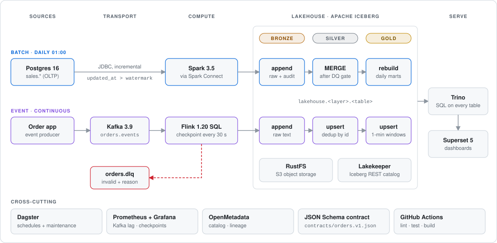

# Architecture — onprem-lakehouse

A fully on-premise lakehouse with **two ingestion patterns (batch + event)** landing in **one Iceberg
lakehouse**, all open-source and free. Nothing in the data path calls a cloud service; GitHub is used
only for code + CI.

## 1. End-to-end flow

  

Close-ups: [Iceberg internals](assets/iceberg.svg) · [batch flow](assets/batch-flow.svg) ·
[event flow](assets/event-flow.svg) · [compose profiles](assets/profiles.svg). The README explains each piece
in plain language.

## 2. Components

| Layer | Tool | Role | Profile |
|---|---|---|---|
| Object storage | **RustFS** | S3 API for all data files | core |
| Table format | **Apache Iceberg** (v2) | ACID, MERGE/upsert, time travel, schema evolution | — |
| Iceberg catalog | **Lakekeeper** | REST catalog shared by Spark, Flink, Trino | core |
| Platform DB | **Postgres 17** | metadata for Lakekeeper, Superset, OpenMetadata | core |
| Batch source | **Postgres 16** | sample OLTP (`sales.*`) | batch |
| Batch compute | **Spark 3.5.8** via **Spark Connect** | JDBC extract, MERGE, marts | batch |
| Orchestration | **Dagster** | daily batch, table maintenance, Flink health | batch / event |
| Event bus | **Kafka 3.9** (KRaft) + Kafka UI | `orders.events`, `orders.dlq` | event |
| Stream compute | **Flink 1.20 LTS** (SQL) | validate → bronze/silver/gold + DLQ | event |
| Event contract | **JSON Schema** | `contracts/orders.v1.json` | — |
| Query engine | **Trino** | SQL over every Iceberg table + the source DB | serving |
| BI | **Superset 5** | dashboards on Trino | serving |
| Monitoring | **Prometheus + Grafana** | Kafka lag, Flink checkpoints, JVM | monitoring |
| Data catalog | **OpenMetadata** | discovery, glossary, lineage, owners | catalog |

## 3. Lakehouse layout

One catalog (`lakehouse`), one namespace per layer, tables prefixed by domain:

| Layer | Batch (Spark) | Event (Flink) | Write pattern |
|---|---|---|---|
| bronze | `sales_customers`, `sales_products`, `sales_orders`, `sales_order_items` | `orders_events_raw` | append-only, raw + audit columns |
| silver | same names | `orders_events` | MERGE on PK / upsert on `(event_date, event_id)` |
| gold | `sales_daily`, `sales_customer_ltv` | `orders_current_status`, `orders_revenue_per_minute` | atomic replace / upsert / windowed append |

Data files: `s3://lakehouse/warehouse/...` in RustFS. Browse it in Trino as `lakehouse.<layer>.<table>`.

## 4. Batch pattern (Spark)

1. **bronze** — per table, read `max(updated_at)` from bronze, JDBC-pull only newer rows, append with
   `_batch_id`, `_ingested_at`, `_source`.
2. **silver** — only bronze rows newer than silver's `_ingested_at`; `row_number()` keeps the latest
   version per PK; clean; **DQ gate** (fails the run before publishing); `MERGE INTO`.
3. **gold** — marts rebuilt with `CREATE OR REPLACE` (readers never see partial data).
4. **Idempotent**: re-running any step never duplicates data (watermark + MERGE).

Spark Connect means the pipeline code is a thin client. Scale-out on-prem = point `SPARK_MASTER` at a
Spark standalone/K8s cluster, or swap the server for **Sail** (Spark Connect compatible) — no code change.

## 5. Event pattern (Flink SQL, one job, five sinks)

| Sink | What | Guarantee |
|---|---|---|
| `bronze.orders_events_raw` | every Kafka record as raw text + partition/offset | at-least-once |
| `silver.orders_events` | parsed + validated, Iceberg **upsert** on `(event_date, event_id)` | effectively-once |
| `orders.dlq` (Kafka) | invalid records + `error` reason | at-least-once |
| `gold.orders_current_status` | latest state per order (upsert) | effectively-once |
| `gold.orders_revenue_per_minute` | 1-min event-time windows, deduped per order | append, final per window |

- Source reads raw text, so **bad JSON never crashes the job** — it's classified and routed to the DLQ.
- Iceberg commits and Kafka offsets happen on each **checkpoint (30 s)** → that's the silver latency.
- Validation rules mirror `contracts/orders.v1.json`; the producer is tested against it in CI.

## 6. Operations

| Concern | How |
|---|---|
| Small files / snapshots | Dagster `lake_maintenance` daily 03:00: `rewrite_data_files` + `expire_snapshots` on **all** tables (incl. Flink's) |
| Streaming health | Dagster `flink_health_job` (every 5 min, enable in UI) + Grafana checkpoint panel |
| Replays | Kafka retention 7 d; bronze keeps everything; silver/gold upserts absorb duplicates |
| Schema change | add field to contract → Flink SQL → `ALTER TABLE` (Iceberg schema evolution) |
| Secrets | `.env` (git-ignored); move to Docker secrets / Vault on a shared server |
| Backups | RustFS bucket + `platform-db` (Lakekeeper metadata!) — back up both together |

## 7. Growing from laptop to on-prem cluster

| Component | Laptop (this repo) | On-prem production |
|---|---|---|
| RustFS | 1 node | distributed (4+ nodes, erasure coding) |
| Kafka | 1 broker, RF 1 | 3 brokers, RF 3, + schema registry (Apicurio) |
| Flink | session cluster, 1 TM | 2+ TMs, RocksDB state, HA via ZooKeeper/K8s, savepoints on RustFS |
| Spark | local mode in Spark Connect | standalone/K8s cluster behind Spark Connect, or Sail |
| Lakekeeper | 1 instance | 2+ behind a load balancer, OIDC auth (Keycloak) + OpenFGA authz |
| Trino | single node | coordinator + workers |
| Dagster | `dagster dev` | webserver + daemon, Postgres run storage |
| Deploy | Docker Compose | Kubernetes (same images) |

## 8. Ports

| Service | URL |
|---|---|
| Dagster | http://localhost:3000 |
| Grafana | http://localhost:3001 |
| Kafka UI | http://localhost:8080 |
| Flink UI | http://localhost:8081 |
| Superset | http://localhost:8088 |
| Trino | http://localhost:8090 |
| Lakekeeper UI | http://localhost:8181/ui |
| OpenMetadata | http://localhost:8585 |
| Prometheus | http://localhost:9090 |
| RustFS console | http://localhost:9001 |
| Spark UI / Connect | http://localhost:4040 · sc://localhost:15002 |
| Postgres source / platform | localhost:5432 · localhost:5433 |
| Kafka (host clients) | localhost:29092 |
